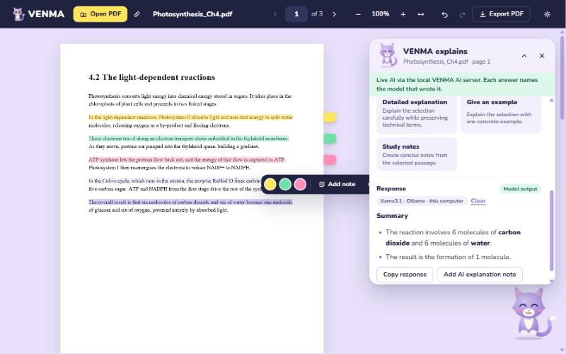
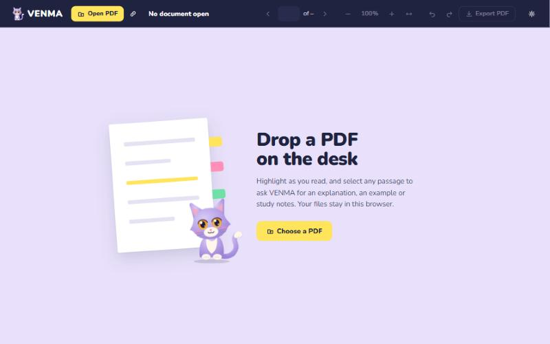
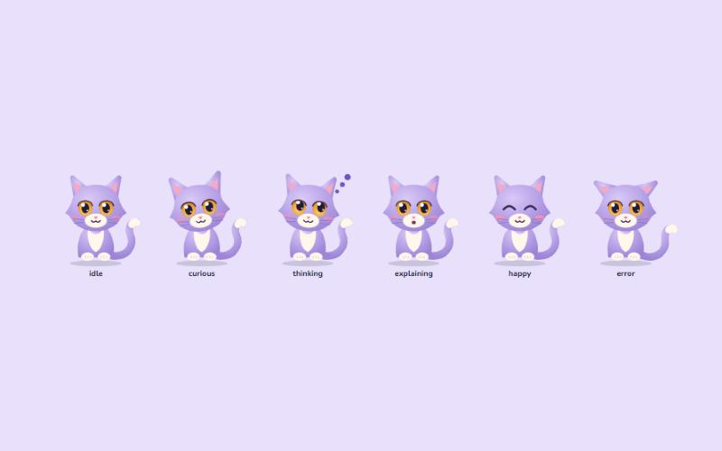
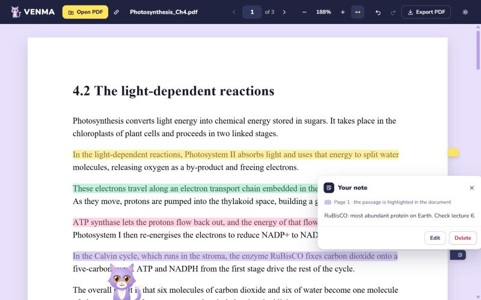
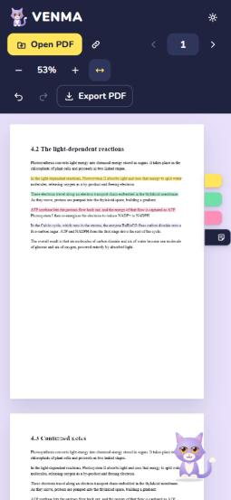

# VENMA AI PDF Viewer

A Chrome extension that turns PDF reading into a reading desk with a companion. Open a PDF, highlight as you read, and select any passage to ask **VENMA**, a lavender cat who lives on your desk, for an explanation, an example, a summary or study notes. Answers can be kept as notes pinned to the page.



## Features

- **PDF workspace:** open a file, drag one onto the desk, or load it from a URL. Page navigation, zoom and fit-to-width included.
- **Highlights and notes:** highlight in yellow, mint or pink, or add a note. Every mark gets a sticky flag on the page edge.
- **Ask VENMA:** select text and choose *Explain*, *Detailed explanation*, *Give an example*, *Summarize* or *Study notes*. Each answer names the model that wrote it.
- **Keep answers as notes:** an answer can be saved onto the page. Opening it lights up the passage it explains.
- **Saved automatically:** highlights and notes are stored in your browser and reattach when you reopen the same PDF.
- **Export:** export a copy of the PDF with your annotations. The original file is never modified.
- **A living companion:** VENMA breathes, blinks, twitches its ears, sways its tail and follows your cursor. It tilts its head at a selection, thinks while a model works, smiles when an answer lands and glances at new flags. VENMA can be hidden at any time, and it holds still when your system asks for reduced motion.

| Empty desk | VENMA's moods |
|---|---|
|  |  |

| A saved note, with its passage highlighted | On a phone-sized window |
|---|---|
|  |  |

## How it works

```
Chrome extension (workspace page)          Local API server (Node / Express)
  React + pdf.js + pdf-lib         ──►       holds every API key
  annotations in IndexedDB                   picks a reachable model
  only the selected text is sent             └─► Ollama (on your computer)
                                             └─► OpenRouter / Groq / Gemini (optional)
```

The extension never contains an API key. All keys live in a `.env` file read by the small server in `server/`, and Vite only exposes variables prefixed `VITE_`, none of which hold secrets.

## Getting started

Requirements: Node.js 20 or newer, and Google Chrome.

```bash
npm install
cp .env.example .env
```

### Free AI with no API key (recommended)

1. Install [Ollama](https://ollama.com).
2. Pull an open model:
   ```bash
   ollama pull llama3.1
   ```
3. Keep `OLLAMA_MODEL=llama3.1` in `.env`.

Ollama runs the model on your own computer, so nothing you select leaves your machine. On a laptop CPU an answer takes roughly 10 to 40 seconds.

### Optional free cloud tiers

Fill in any of these in `.env` (sign-up required, free tiers have daily limits):

| Provider | Variables | Notes |
|---|---|---|
| OpenRouter | `OPENROUTER_API_KEY`, `OPENROUTER_MODEL` | use a model ID ending in `:free` |
| Groq | `GROQ_API_KEY`, `GROQ_MODEL` | fast hosted open models |
| Google AI Studio | `GEMINI_API_KEY`, `GEMINI_MODEL` | Gemini models |

The assistant's **Auto** option uses the first reachable model, in the order set by `AI_MODEL_PRIORITY`.

### Run it

```bash
npm run dev:full
```

This starts the workspace at `http://127.0.0.1:5173/workspace.html` and the AI server on port 3001.

### Load it as a Chrome extension

1. Build the extension:
   ```bash
   npm run build
   ```
2. Open `chrome://extensions`, turn on **Developer mode**, click **Load unpacked** and choose the `dist` folder.
3. Copy the extension's ID and add `chrome-extension://<your-id>` to `CORS_ORIGINS` in `.env`.
4. Start the AI server:
   ```bash
   npm run dev:server
   ```
5. Click the VENMA icon in Chrome's toolbar to open the workspace.

## Scripts

| Command | What it does |
|---|---|
| `npm run dev:full` | workspace and AI server together |
| `npm run build` | type-check and build the extension into `dist/` |
| `npm run test:pdf` | PDF loading smoke test |
| `npm run test:ai` | AI server tests (routing, fallback, key handling) |
| `npm run check:secrets` | fail if any key from `.env` appears in the code or the build |

Run `npm run check:secrets` before every push.

## Project layout

```
src/
  app/          app shell and state
  features/pdf  reader, annotation layer, flags, toolbars
  features/pet  VENMA (VenmaCat.tsx) and the assistant drawer
  services/     PDF loading, annotation storage/export, AI client
  styles/       global.css (design tokens in :root)
server/         local AI server (provider routing, validation)
scripts/        check-secrets.mjs
tests/          smoke and API tests
```

The visual system is documented in [DESIGN.md](DESIGN.md) and the product principles in [PRODUCT.md](PRODUCT.md).

## Privacy

- PDFs and annotations stay in your browser.
- Only the passage you select (and a little surrounding context) is sent to the AI server.
- With Ollama, that text never leaves your computer.
